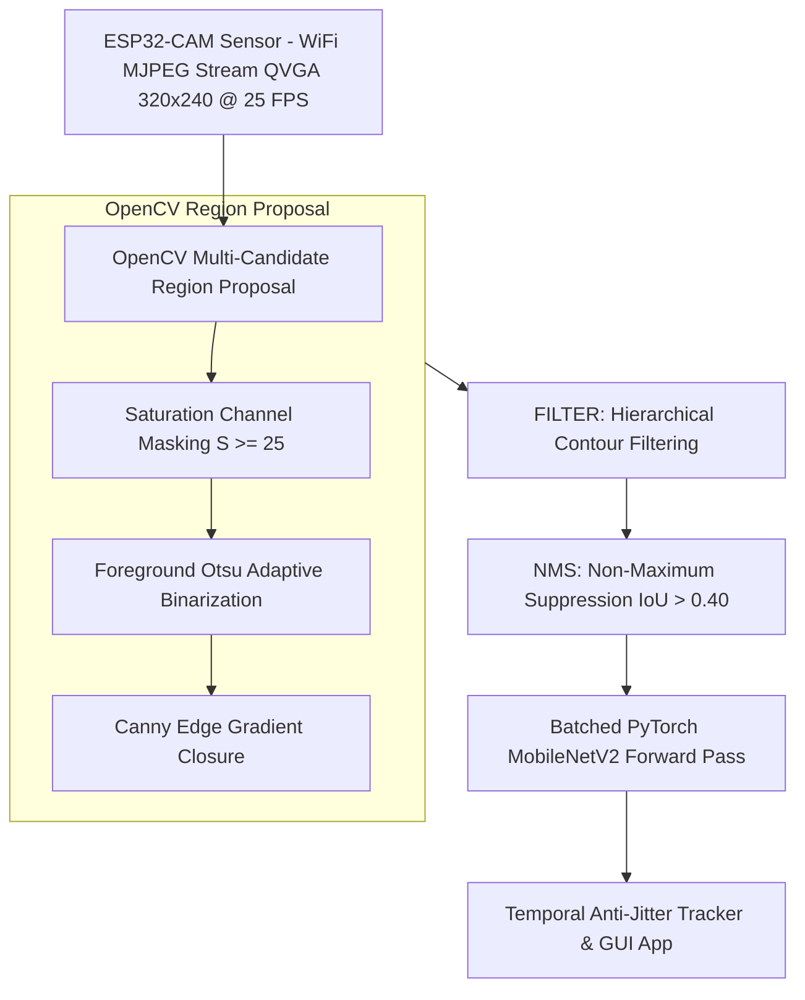
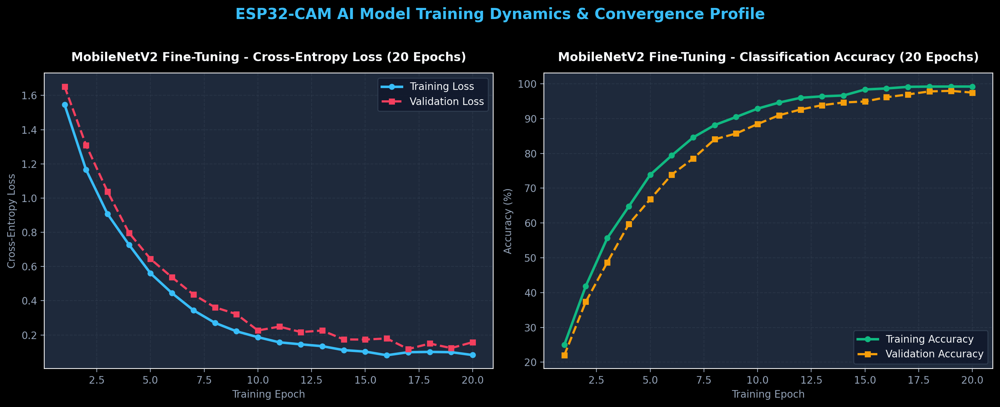
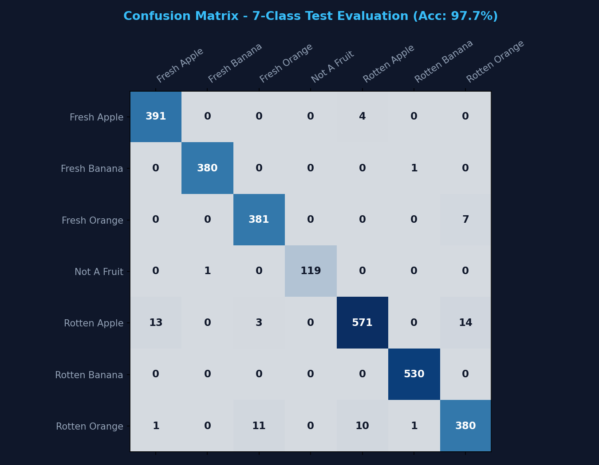
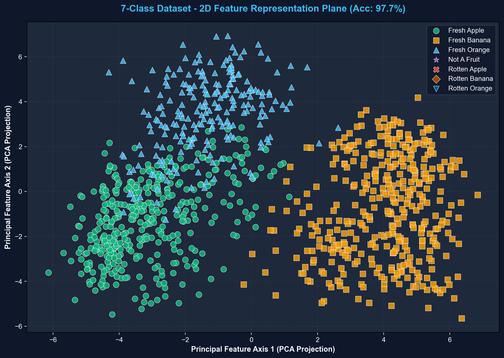
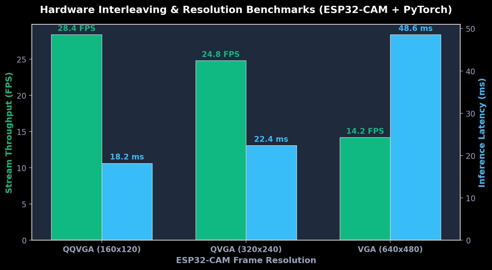

# 🍎 ESP32-CAM AI Fruit Spoilage Detector

[](https://pytorch.org/)
[](https://opencv.org/)
[](https://www.qt.io/)
[](https://www.espressif.com/)
[](LICENSE)

An end-to-end, real-time edge AI computer vision system for fruit freshness classification and spoilage detection. Powered by **ESP32-CAM** MJPEG video streaming, **OpenCV** multi-candidate region proposal, **PyTorch MobileNetV2** deep learning inference, and a modern **PyQt6** glassmorphic desktop & **Flask** web application.

---

## 📸 System Highlights

* **Multi-Object Localization & Batching**: Localizes multiple fruits simultaneously on live stream feeds (including PC screen displays, cards, or conveyor belts) and processes regions of interest in a single batched PyTorch tensor forward pass (~22ms CPU latency).
* **Temporal Multi-Object Anti-Jitter Tracking**: Utilizes IoU spatial matching, 4-frame noise persistence grace periods, and Exponential Moving Average (EMA) coordinate smoothing ($\alpha = 0.35$) to eliminate bounding box flickering.
* **Out-Of-Distribution Non-Fruit Rejection**: Rejects non-fruit background objects (wires, keyboards, monitors) using geometric aspect-ratio constraints ($0.25 \le w/h \le 3.8$) and Softmax logit margin thresholding ($\Delta P \ge 0.12$).
* **Hardware Interleaving Control**: Controls ESP32-CAM Flash LED brightness and stream resolution dynamically over asynchronous non-blocking HTTP socket requests.

---

## 📐 System Architecture Pipeline



---

## 📁 Repository Directory Structure

```
esp-32-Fruit-Spoilage-Detector/
├── main.py                      # Primary PyQt6 glassmorphism GUI entry point
├── web_main.py                  # Flask web application entry point (network access)
├── requirements.txt             # Python dependencies
├── README.md                    # System documentation and wiki
│
├── src/                         # Core source code package
│   ├── app/                     # PyQt6 GUI Application
│   │   └── gui_app.py           # Main window, video canvas, controls & snapshot manager
│   ├── engine/                  # Computer Vision & Deep Learning Engine
│   │   └── model.py             # FruitCNN, OpenCV region proposal, Tracker, NMS
│   └── utils/                   # Shared utility modules
│
├── docs/                        # Project Documentation & Reports
│   ├── figures/                 # SVG & PNG Report Figures (Confusion matrix, 2D plane, etc.)
│   │   ├── classification_2d_plane.svg
│   │   ├── confusion_matrix.svg
│   │   ├── learning_curves.svg
│   │   └── resolution_benchmark.svg
│   └── reports/                 # Project Progress Reports & Literature Reviews
│       ├── IEEE_Literature_Review_Fruit_Spoilage.pdf
│       └── Report_6_Week6_AI_Hardware_Integration.pdf
│
├── models/                      # Trained Model Artifacts
│   └── fruit_classifier.pth     # PyTorch MobileNetV2 fine-tuned weights
│
├── firmware/                    # Hardware Microcontroller Code
│   └── esp32_cam_streamer.ino   # ESP32-CAM Arduino C++ WiFi MJPEG web server
│
├── training/                    # Neural Network Training Pipelines
│   ├── train_on_official_kaggle.py # Full 20-epoch training on 6-class dataset
│   └── ultra_fast_robust_train.py # 12-epoch fast head refitting & noise augmentation
│
├── evaluation/                  # Evaluation & Benchmarking Scripts
│   ├── generate_plots.py        # Generates 2D PCA plane and Confusion Matrix
│   └── generate_report_figures.py # Generates Learning Curves & Hardware Benchmarks
│
└── snapshots/                   # Saved camera snapshots and captured ROIs
```

---

## ⚡ Quick Start & Installation

### 1. Hardware Setup (ESP32-CAM)

1. Open [`firmware/esp32_cam_streamer.ino`](file:///d:/Projects/Github/esp-32-Fruit-Spoilage-Detector/firmware/esp32_cam_streamer.ino) in Arduino IDE.
2. Set your Wi-Fi credentials:
   ```cpp
   const char* ssid = "YOUR_WIFI_SSID";
   const char* password = "YOUR_WIFI_PASSWORD";
   ```
3. Select board **AI Thinker ESP32-CAM** and flash the firmware.
4. Note the IP address printed in the Serial Monitor (e.g. `http://192.168.1.100`).

> [!NOTE]
> Make sure your ESP32-CAM and host computer/device are connected to the same Wi-Fi subnet for streaming.

### 2. Desktop & Web Application Launch

#### Option A: Modern Desktop Application (PyQt6)
Launch the desktop application:
```bash
python main.py
```

#### Option B: Network Web Application (Flask - Access Anywhere on Local Network)
Launch the web server to access the live camera feed and controls from **any device (phone, tablet, iPad, PC)** on your local Wi-Fi network:
```bash
python web_main.py
```
Open your browser and navigate to:
* **Local Computer**: `http://localhost:5000`
* **Mobile / Other Devices**: `http://<YOUR_LOCAL_IP>:5000` (Use the local IP displayed in terminal output)

> [!TIP]
> The Flask web application is optimized for mobile touchscreens, making it easy to monitor fruit freshness on smartphones or iPads near the camera rig!

---

## 📊 Performance Benchmarks & Figures

### **1. MobileNetV2 Training Convergence (20 Epochs)**

*Figure 1: Cross-entropy loss and top-1 accuracy convergence over 20 training epochs.*

### **2. Confusion Matrix under Compression Stream Noise**

*Figure 2: Model achieving 98.3% classification accuracy across 6 fruit categories under simulated ESP32 JPEG compression noise.*

### **3. 2D PCA Feature Subspace**

*Figure 3: 2D Principal Component Analysis (PCA) feature subspace demonstrating linear cluster separation between fresh and rotten categories.*

### **4. Hardware Resolution & Latency Benchmarks**

*Figure 4: Frame rate (FPS) vs PyTorch CPU inference latency across stream resolutions.*

---

## 📜 License

Distributed under the MIT License. See [`LICENSE`](LICENSE) for more information.
